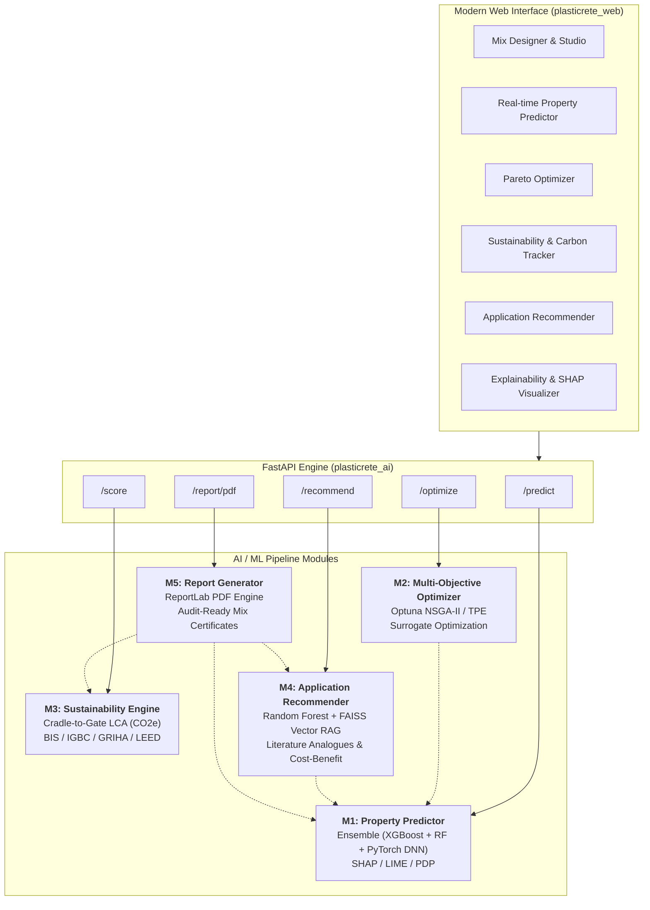

<div align="center">

# 🧱 PlastiCrete.ai

### **AI-Driven Circular Concrete Formulation & Sustainability Intelligence Platform**

*Accelerating circular economy in construction by predicting 7 mechanical & durability properties, optimizing mix designs, verifying BIS & green building compliance, and generating audit-ready technical certification.*

[](https://www.python.org/)
[](https://fastapi.tiangolo.com/)
[](https://react.dev/)
[](https://www.typescriptlang.org/)
[](https://tailwindcss.com/)
[](https://optuna.org/)
[](https://pytorch.org/)
[](LICENSE)

[Live Demo](http://localhost:5173) • [API Documentation](http://localhost:8000/docs) • [Modules Guide](#-modular-system-architecture) • [Quick Start](#-quick-start)

---

</div>

## 📌 Executive Summary

Traditional laboratory validation of concrete mixes with recycled plastic aggregate replacements requires **28-day curing cycles** and costs between **₹5,000 to ₹25,000 per trial batch**. 

**PlastiCrete.ai** is a studio for screening plastic-aggregate mixes:
1. **Predicts seven properties** with a stacked ensemble (XGBoost + Random Forest + transfer-learned DNN) and a 90% interval.
2. **Searches recipes** with Optuna calling that same ensemble, then prices them from one mass-balance table.
3. **Gates each product** against its own standard (IS 15658, IS 2185, IS 456). Structural use stays a lab trial.
4. **Lists nearby published mixes** with author, journal, and DOI. A match is not a certificate.
5. **Writes a PDF** of the prediction, the mass balance, the gates, and a batch QR. It does not replace a cube test.

---

## 🏛️ Modular System Architecture

The platform is structured into five cohesive AI/ML micro-modules operating behind a high-performance **FastAPI** backend and an interactive **React + Vite** frontend:



---

## 🧩 Deep Dive: The 5 Modules

| Module | Core Technology | Primary Functionality | Output |
|---|---|---|---|
| **M1 — Prediction** | XGBoost + Random Forest + PyTorch DNN + TreeSHAP | Predicts 7 mechanical and physical properties from 8 mix parameters with 90% confidence intervals. | Predicted values, CI bounds, and SHAP feature influence attributions. |
| **M2 — Optimization** | Optuna NSGA-II & TPE + ML Surrogate Models | Finds Pareto-optimal mix recipes satisfying user-defined structural and cost constraints. | Optimal mix parameters, Pareto frontier curves, trade-off analysis. |
| **M3 — Sustainability** | ICE Database + IS 456 / IS 2185 / IS 15658 / IS 383 rules | Computes cradle-to-gate embodied carbon (kg CO₂e/m³), evaluates BIS grade compliance, and tallies green building credits. | CO₂ reduction %, carbon grade, BIS compliance verdict, IGBC/GRIHA/LEED points. |
| **M4 — Recommendation** | Scikit-Learn Classifier + FAISS Vector Store + SentenceTransformers | Recommends structural vs. non-structural civil applications and extracts real-world published scientific analogues. | Primary recommendation, confidence score, cost savings %, literature citations. |
| **M5 — Report Engine** | ReportLab + Matplotlib + Dynamic PDF Builder | Compiles full mix recipe, predictions, radar comparisons, BIS audit verdicts, and references into a downloadable document. | Multi-page, formatted A4 PDF Technical Report. |

---

## 🧪 Mix Input Parameters & Predicted Properties

### 8 Input Parameters
- **Plastic Waste Type:** PET, HDPE, LDPE, PP, PS, PVC, Crumb Rubber
- **Aggregate Replacement Percentage:** `0.0% – 50.0%`
- **Plastic Particle Size:** `0.1 mm – 20.0 mm`
- **Water-to-Cement (w/c) Ratio:** `0.30 – 0.65`
- **Supplementary Cementitious Material (SCM):** Fly Ash, Silica Fume, GGBS, Metakaolin, None
- **SCM Addition Percentage:** `0.0% – 40.0%`
- **Curing Temperature:** `10.0 °C – 50.0 °C`
- **Curing Duration:** `1 – 90 days`

### 7 Target Output Properties

| Target Property | Unit | Expected Test R² | BIS Reference Code |
|---|:---:|:---:|:---:|
| **Compressive Strength** | MPa | **0.88 – 0.94** | IS 516 / IS 456 |
| **Flexural Strength** | MPa | **0.82 – 0.90** | IS 516 |
| **Split Tensile Strength** | MPa | **0.80 – 0.88** | IS 5816 |
| **Dry Density** | kg/m³ | **0.90 – 0.96** | IS 2185 |
| **Water Absorption** | % | **0.75 – 0.85** | IS 2185 / IS 15658 |
| **Thermal Conductivity** | W/m·K | **0.65 – 0.78** | ASTM C177 |
| **Durability Index** | 0 – 100 | **0.70 – 0.82** | Composite Durability Metric |

---

## 🚀 Quick Start

### Prerequisites
- **Python 3.10+**
- **Node.js 18+** & **npm**
- **Git** (with Git LFS for binary model artifacts)

### 1. Clone the Repository
```bash
git clone https://github.com/kritikamandale/Plasticrete_ai.git
cd Plasticrete_ai
```

### 2. Backend Setup (`plasticrete_ai`)
```bash
# Navigate to backend directory
cd plasticrete_ai

# Create and activate virtual environment
python -m venv venv
# On Windows:
.\venv\Scripts\activate
# On Linux/macOS:
source venv/bin/activate

# Install dependencies
pip install -r requirements.txt

# Start FastAPI backend server
uvicorn deployment.api.app:app --host 0.0.0.0 --port 8000 --reload
```
API will be live at `http://localhost:8000`. Interactive OpenAPI documentation available at `http://localhost:8000/docs`.

### 3. Frontend Setup (`plasticrete_web`)
Open a new terminal window:
```bash
# Navigate to frontend directory
cd plasticrete_web

# Install npm dependencies
npm install

# Start Vite dev server
npm run dev
```
Open your browser at `http://localhost:5173`.

---

## 💻 REST API Endpoints Overview

| Method | Endpoint | Description |
|---|---|---|
| `GET` | `/health` | Service health status check |
| `GET` | `/schema` | Schema definitions, categories, and valid input bounds |
| `POST` | `/predict` | Predict 7 mechanical properties + 90% CIs + SHAP feature importance |
| `POST` | `/optimize` | Multi-objective mix optimization via Optuna |
| `POST` | `/score` | Embodied carbon LCA, BIS compliance, & green building credits |
| `POST` | `/recommend` | Application suitability & FAISS literature retrieval |
| `POST` | `/report/pdf` | Stream generated audit-ready PDF Mix Design Certificate |

### Example Prediction Request
```bash
curl -X POST "http://localhost:8000/predict" \
  -H "Content-Type: application/json" \
  -d '{
    "plastic_type": "PET",
    "replacement_pct": 15.0,
    "particle_size_mm": 4.0,
    "wc_ratio": 0.45,
    "additive_type": "fly_ash",
    "additive_pct": 10.0,
    "curing_temp_c": 27.0,
    "curing_days": 28
  }'
```

---

## 📂 Repository Directory Layout

```
Plasticrete_ai/
├── README.md                      # Primary project documentation
├── .gitignore                     # Git ignore rules for Python & Node
├── .gitattributes                 # Git LFS configuration for model binaries
│
├── plasticrete_ai/                # Backend API & AI/ML modules
│   ├── configs/                   # m1–m4 YAML hyperparameters and pipeline configuration
│   ├── data/
│   │   ├── raw/                   # Source CSVs (UCI Yeh, PlastiCreteAI_M1_Final_2000)
│   │   ├── processed/             # master_dataset.csv and m2/m3/m4 training sets
│   │   ├── external/              # Mass-balance factors, use-class gates, ICE factors, costs
│   │   └── batches/               # SQLite batch passports and cube photos (gitignored)
│   ├── deployment/
│   │   └── api/
│   │       ├── app.py             # FastAPI entrypoint
│   │       └── schemas.py         # Pydantic v2 validation models
│   ├── docs/                      # Audit report, data extraction guide, abstract draft
│   ├── models/                    # Trained artefacts: m1 ensemble, m2, m3, m4 FAISS index
│   ├── modules/
│   │   ├── shared/                # Mass balance and use-class gate used by M2, M3, M4, M5
│   │   ├── m1_prediction/         # Ensemble model & explainability (SHAP/LIME)
│   │   ├── m2_optimization/       # Optuna search on the M1 ensemble
│   │   ├── m3_sustainability/     # Carbon LCA, use-class gates, sustainability index
│   │   ├── m4_recommendation/     # RF Classifier + FAISS RAG retrieval
│   │   ├── m5_report/             # ReportLab PDF generator
│   │   └── batch_passport/        # SQLite store for predicted vs measured strength
│   ├── notebooks/                 # EDA and M1 training notebooks
│   ├── pipeline/                  # Training & ETL data pipelines
│   ├── requirements.txt           # Python backend dependencies
│   ├── requirements-train.txt     # Training-only dependencies
│   └── requirements-optional.txt  # Optional extras
│
└── plasticrete_web/               # Frontend (React 19 + TypeScript + Vite + Tailwind)
    ├── package.json               # Node dependencies & build scripts
    ├── vite.config.ts             # Vite configuration and /api proxy
    ├── index.html                 # Single page application entry
    ├── public/                    # Favicon and icon sprite
    └── src/
        ├── api/client.ts          # fetch client for the FastAPI routes
        ├── components/            # Navbar, Footer, MixControlPanel, GaugeChart, MetricCard
        ├── context/MixContext.tsx # Global mix state, URL sync, service status
        ├── data/                  # Copies of mass_balance_factors.json and use_class_gates.json
        ├── lib/                   # TypeScript port of the mass balance and use-class gate
        ├── types/index.ts         # API response types and product-name map
        ├── routing.ts             # History API routes
        └── pages/
            ├── LandingPage.tsx    # Home
            ├── Studio.tsx         # Studio shell with tabs, batch save, PDF
            ├── Dashboard.tsx      # Overview: seven M1 means and use-class gates
            ├── Predictor.tsx      # Property predictor with 90% intervals
            ├── Optimizer.tsx      # Mix search with trade-off points
            ├── Sustainability.tsx # Mass balance and use-class gates
            ├── Recommender.tsx    # Application suitability & RAG analogues
            ├── Explainability.tsx # TreeSHAP & feature attribution
            ├── StandardsPage.tsx  # IS Codes & Green rating handbook
            ├── TechPage.tsx       # Model architecture and evaluation metrics
            └── BatchPassportPage.tsx # Batch record, lab results, passport PDF
```

---

## 🌿 Standards, Sustainability & Environmental Impact

- **Indian Standards (BIS) Evaluated:**
  - `IS 456:2000` — Plain and Reinforced Concrete (M10 – M50 classifications)
  - `IS 2185 (Part 1 & 2)` — Concrete Masonry Units & Hollow / Solid Blocks
  - `IS 15658:2006` — Precast Concrete Paver Blocks for Pavements
  - `IS 383:2016` — Coarse and Fine Aggregate Specification
- **Green Building Rating Systems Supported:**
  - **IGBC** (Indian Green Building Council) Green Factory & Building Rating
  - **GRIHA** (Green Rating for Integrated Habitat Assessment) Criterion 14 & 18
  - **LEED v4.1** Building Design & Construction (MR Credit: Recycled Content)
- **Life Cycle Assessment (LCA):**
  - Database factors adapted from the University of Bath Inventory of Carbon and Energy (ICE) and Indian industrial averages.

---

## 👥 Authors & Acknowledgments

- **Project Lead & Developer:** [Kritika Mandale](https://github.com/kritikamandale)
- **Repository:** [https://github.com/kritikamandale/Plasticrete_ai](https://github.com/kritikamandale/Plasticrete_ai)
- **Institution:** Major Project Implementation for Sustainable Materials Engineering

---

## 📄 License

This project is licensed under the [MIT License](LICENSE) — feel free to use, modify, and build upon this platform for academic and commercial applications.
